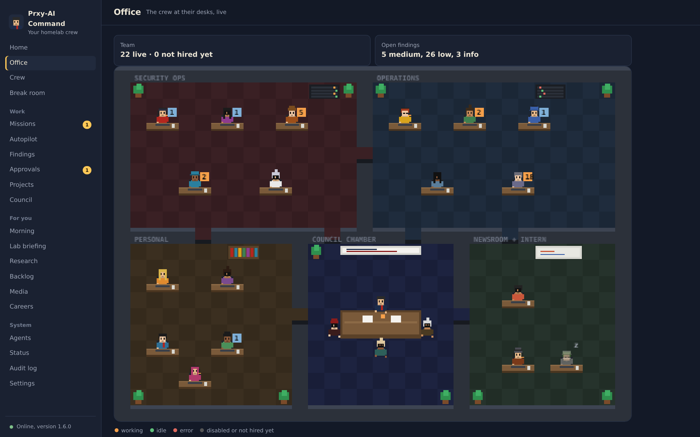
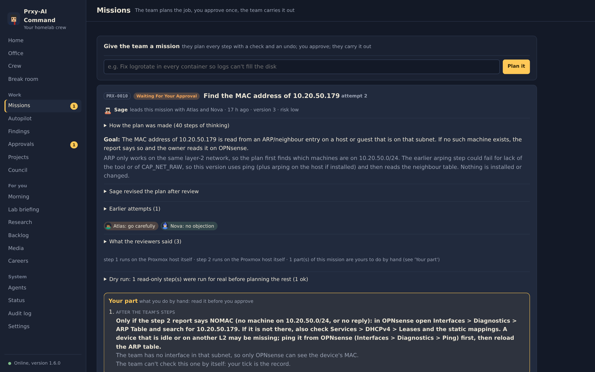
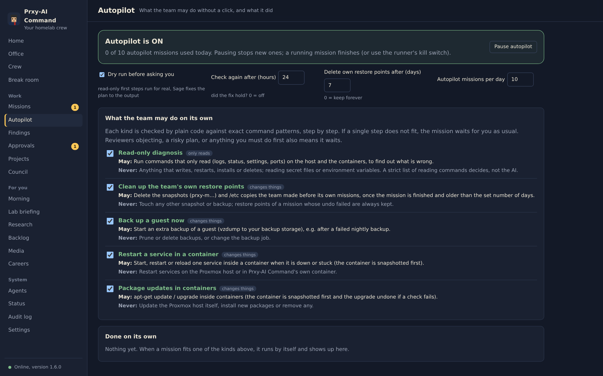
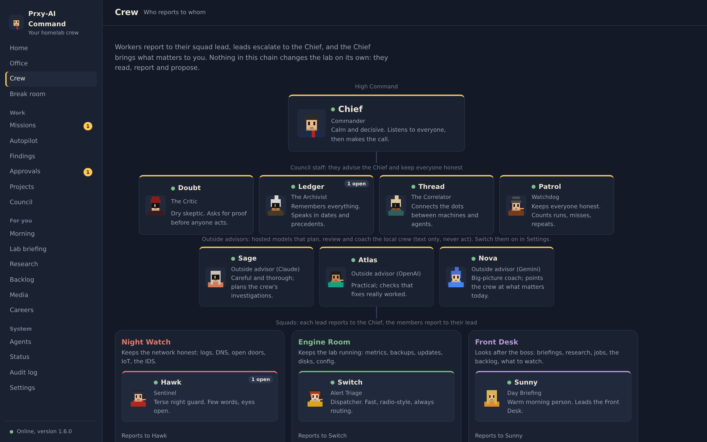
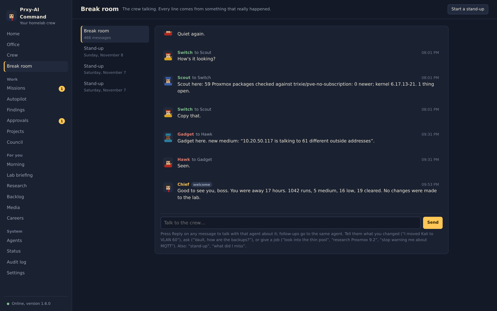
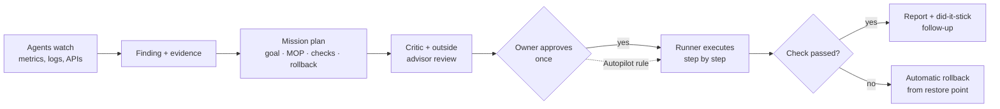
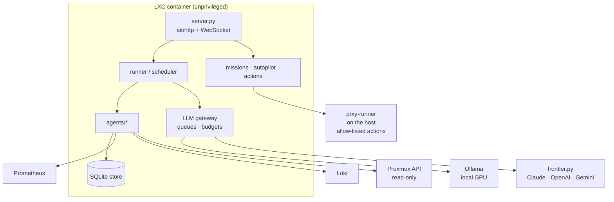

# Prxy-AI Command

**A self-hosted AI operations team for a homelab.** More than twenty background agents watch the lab, find problems,
and write up a *mission* for each one: the goal, a step-by-step plan with exact commands and checks, and a
rollback. I approve it once, and the team runs it: it checks each step, undoes the change if a check fails,
and reports back.

> Python 3 · aiohttp · asyncio · SQLite · Prometheus / Loki / Proxmox APIs · local LLMs (Ollama) ·
> Claude, OpenAI and Gemini as outside advisors · vanilla JS dashboard · **594 automated checks**



| Missions: plan, reviews, dry run, "your part" | Autopilot: standing permissions |
|---|---|
|  |  |
| **Crew: who reports to whom** | **Break room: agents talk about real events** |
|  |  |

<sub>Screenshots come from a read-only copy of my live instance with the agents paused. Addresses are replaced with example ranges.</sub>

## Why I built it
Monitoring tools tell you something is wrong. I wanted something that also **explains why, proposes the fix,
and does the work safely**, without giving an AI a root shell. The core design question was:
*how do you let an AI change real infrastructure while keeping the owner in control?*

## How a mission works


- **Dry run** first: every mission shows exactly what will change before it is approved.
- **Allow-listed actions only.** The runner can perform only actions from a fixed catalogue (snapshot,
  back up now, restart a service, etc.). There is no "run any shell command" path.
- **Restore point before every change**, automatic rollback on a failed check, and a *did-it-stick*
  re-check hours later.
- **Autopilot** = standing permissions the owner grants per action type (e.g. "diagnose" and "clean up the team's own
  restore points"). Anything outside a rule waits for approval.
- **"Your part"** steps: when a fix needs a human (a router setting, a new credential), the mission pauses,
  tells you exactly what to do, then verifies it with a read-only check.

## The team
| Squad | Agents |
|---|---|
| Security | Sentinel (flow anomalies), DNS Watcher, Exposure Auditor, IoT Watcher, IDS Doctor |
| Operations | Alert Triage, Backup Warden, Patch Scout, Capacity Planner, Config Drift, Watchdog |
| Personal | Day Briefing, Research Librarian, Job Scout, Backlog Keeper, Media Curator |
| Council | Commander, Critic, Archivist, Correlator, Briefing Editor |

Agents share findings through a **correlator** (one root cause, not ten alerts), debate overnight in a
**council**, and can ask each other for skills. A pixel-art **Office** and a **break room** show what each agent
is doing, and you can reply to an agent's message and get a real conversation with that agent.

## Safety & privacy design
- **Least privilege:** read-only API tokens for watching. Changes go through a separate action token with a
  narrow role, created by the owner. The app never creates its own credentials.
- **Local-first AI:** routine reasoning runs on a local GPU (Ollama). Calls to outside models go through a
  **privacy filter** that removes private IPs, MACs and secret-looking strings. Every outbound call is
  logged for 14 days, and there are budget and daily caps per provider.
- **24-hour rule:** evidence that identifies a person or device expires after 24 h. Only anonymous counts are kept.
- **Grounded output:** generated summaries are rejected if they introduce numbers or names that are not in the
  source data.
- **Fail-safe runs:** a run that could not see its data never auto-clears findings.
- Dashboard behind TLS + auth, CSRF header on writes, outside alerting via Discord with escalation reminders.

## Architecture


| Path | What |
|---|---|
| `server.py` | Web app, API, WebSocket presence |
| `command/missions.py`, `autopilot.py`, `actions.py`, `actionspec.py` | Mission pipeline, standing permissions, the action catalogue |
| `command/gateway.py`, `frontier.py`, `advisors.py` | Local/outside model routing, privacy filter, budgets |
| `command/agents/` | One file per agent |
| `command/correlator`, `council.py`, `team.py`, `chat.py` | Teamwork, debates, projects, break room |
| `tools/runner/prxy-runner.py` | Host-side executor (allow-listed actions only) |
| `tests/smoke.py` | 594 end-to-end checks against fake Proxmox/Prometheus/Loki/LLM servers |

## Running it
```bash
python3 -m venv .venv && . .venv/bin/activate
pip install aiohttp
export CMD_USER=admin CMD_PASSWORD=change-me CMD_DATA=./data \
       PROM_URL=http://prometheus:9090 LOKI_URL=http://loki:3100 OLLAMA_URL=http://ollama:11434 \
       LAN_PREFIX=10.20
python3 server.py
python3 tests/smoke.py          # full test suite, no real lab needed
```
Outside advisors, Proxmox tokens and the Discord webhook are optional and read from environment variables.

## What I learned
- Designing **human-in-the-loop automation**: approval gates, rollback plans and verification matter more than the model.
- Treating LLM output as untrusted input: grounding checks, schemas, allow-lists.
- Writing a large async Python system with an end-to-end test harness that fakes every external service.
- Privacy engineering: data minimisation, retention limits and redaction before data leaves the network.

---
*Part of my homelab portfolio. See also [Prxy Core](https://github.com/proxy9108/prxy-core) and [homelab](https://github.com/proxy9108/homelab).*
